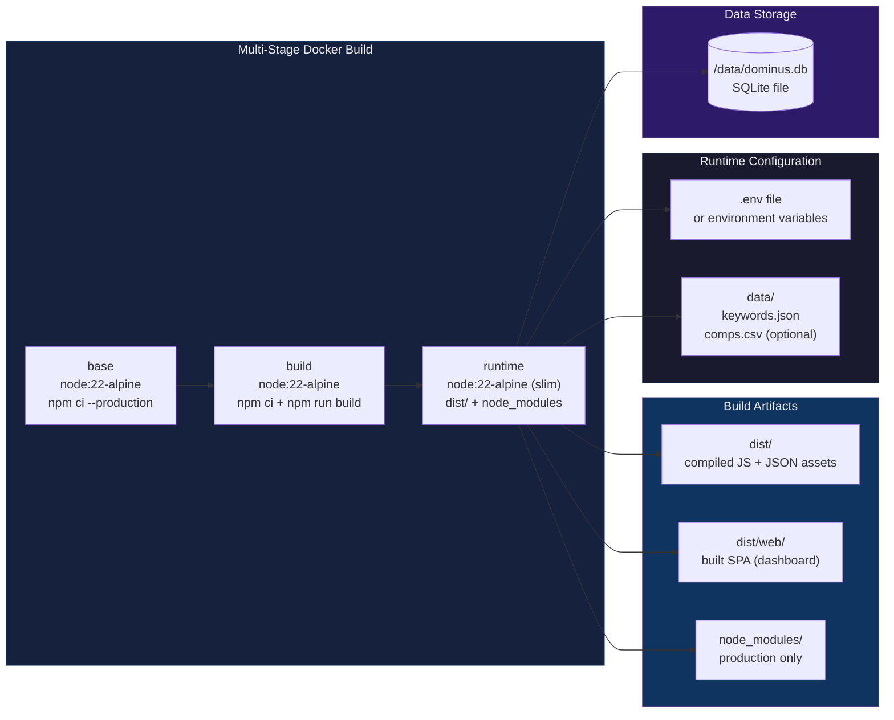
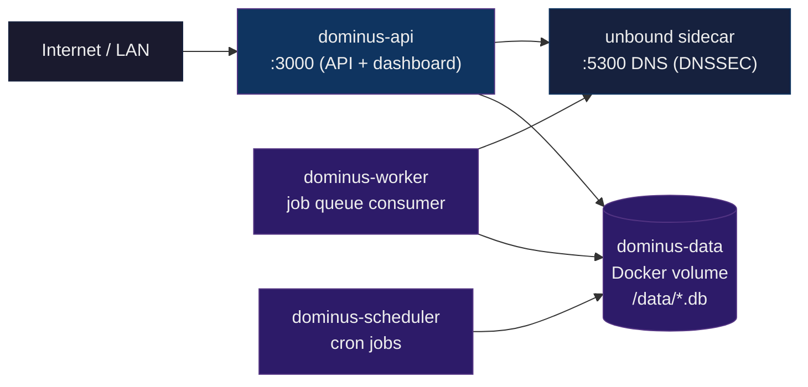
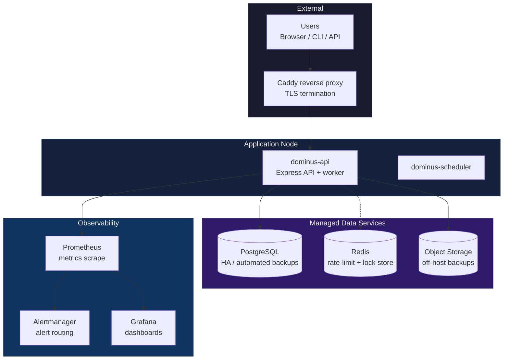

# Deployment Architecture

## Docker Build



`scripts/finalize-dist.mjs` runs after `tsc` to make the build output
complete across every distribution channel: it copies runtime JSON assets
(`tsc` drops non-`.ts` files), stages the compiled SPA at `dist/web/`, and
prunes the compiled test suites.

## Docker Compose (Community Edition)



```bash
# Community edition: SQLite + Unbound validating resolver
docker compose -f docker-compose.yml -f docker-compose.unbound.yml up -d
```

The Unbound overlay is not optional if you want "available" verdicts:
without a validating resolver the DNS stage degrades and never reports a
domain as available (ADR-0072, ADR-0076).

## Docker Compose (DOMINUS Cloud)



```bash
# Cloud stack: PostgreSQL + Redis + Prometheus/Grafana + Unbound
docker compose \
  -f docker-compose.yml \
  -f docker-compose.unbound.yml \
  -f docker-compose.prod.yml up -d
```

Infrastructure-as-code for a dedicated node lives in
[`deploy/terraform/`](../../deploy/terraform/) (Hetzner app node, PITR
database node, and Caddy).

## Resource Requirements

| Edition | CPU | RAM | Storage | Cost |
|---------|-----|-----|---------|------|
| Community (Docker, SQLite) | 0.5 core | 256 MB | 1 GB (SQLite + data files) | ~€0 (existing hardware) |
| Cloud (Compose + PGSQL) | 1 core | 1 GB | 10 GB (PostgreSQL + backups) | ~€25-50/mo |
| Enterprise (Terraform) | 2+ cores | 2+ GB | 40 GB+ NVMe + object storage | on contract |

## Port Mapping

One HTTP port per deployment; there is no dedicated metrics port.

| Port | Protocol | Purpose | Notes |
|------|----------|---------|-------|
| `PORT` (default 3000) | HTTP | REST API + dashboard | bound to `127.0.0.1` by default in compose; expose deliberately |
| `PORT` (same) | HTTP | Prometheus metrics at `/api/v1/metrics/*` | optionally bearer-protected with `METRICS_TOKEN` |
| 5300 | TCP/UDP | Unbound resolver | internal compose network only |
| 9090 | HTTP | worker/scheduler healthcheck | loopback only, never exposed |
